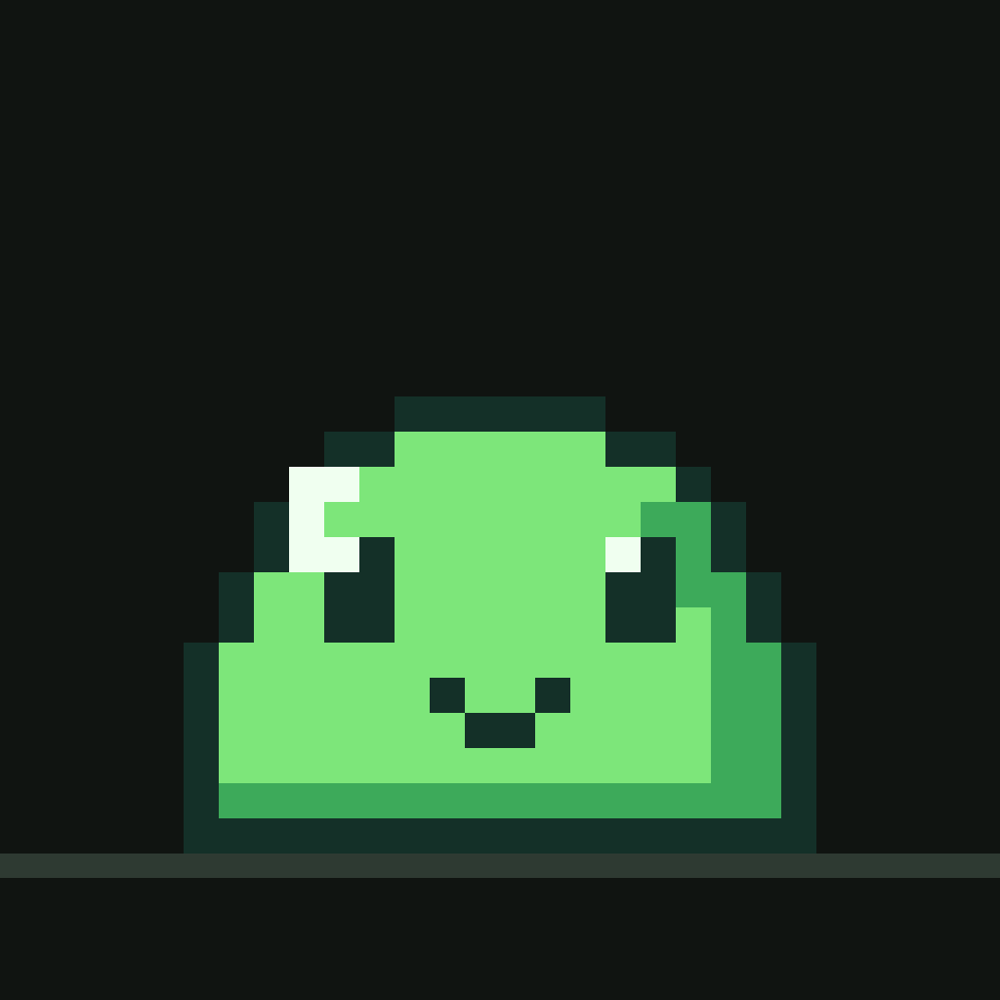

# Slimy

A pixel slime that lives in your iPhone's Dynamic Island. By hyprnode, [slime.hyprnode.de](https://slime.hyprnode.de).

<p align="center"></p>

## What it does

**In the Dynamic Island**
- Your slime sits on the left of the island and moves. On the right, a small pixel emote shows how it feels or what it needs.
- Friends join in: up to two stand beside it in the expanded island and on the Lock Screen. Now and then a friend's slime drops by, and the two slide toward each other and share a heart (a meetup). Hugs, gifts, playing, falling in love and good night get their own shared moments too.
- Touch and hold to open the speech line, the needs and the Feed, Play, Bath and Pet buttons. They work without opening the app.
- The Lock Screen, StandBy and Apple Watch show a card. Control Center has "Summon Slime" and "Feed Slime", both also available for the Action Button.

**The slime**
- Five needs: food, fun, energy, clean, love. They never drop below a resting floor, even if you're away for weeks, and the slime never guilt-trips you.
- Its own personality (playful, cuddly, foodie, sleepy, curious) that drifts over time. You find out its favourite food and favourite game yourself.
- It grows from baby to young to big, each with its own sprites. 18 animations, around 150 lines it doesn't keep repeating, and a journal of memories.
- A bedtime you can set. Changing the clock doesn't confuse it.

**Arcade:** ten games (Snack Catcher, Slime Jump, Bubble Pop, Memory Garden, Slime Racing, Rhythm Bounce, Garden Puzzle, Treasure Dig, Slime Basketball, Color Match). Each has a tutorial, pause (automatic when you leave the app) and records. A round pays out exactly once.

**Collecting:** coins are only earned by playing; there is no real money. Hats, glasses, scarves, furniture, homes (room, garden, beach, space, crystal cave), daily and weekly challenges, 24 achievements.

**Reacting to your iPhone, no setup needed:** battery low or almost empty, battery full, charger plugged in or out, Low Power Mode, Wi-Fi, mobile data, no internet, morning and night. While the app is open it reacts right away. When it's closed, Slimy notices the next time iOS lets it run (background refresh, a background task while charging, or when you tap the island), so a reaction can come a little later. Background App Refresh must be on for Slimy. Airplane mode and alarms can't be observed by apps.

**Widgets:** Home Screen (small, medium) and Lock Screen (circular, rectangular, inline). They need the App Group, see Install.

**Friends** (needs the server in `server/`, see [HANDOVER.md](HANDOVER.md)): share a code, accept the request, hug, visit (their slime comes over to your home), send food, send greetings, kiss from 50%, fall in love at 100%. Challenges on the same game board, a shared weekly garden, blocking, privacy settings, deleting your data. Without a connection everything waits and is sent exactly once later. Until the server runs there's a test friend, Mochi, that lives only on your iPhone.

**Talking** (needs the server): your slime answers briefly and in character. The API key stays on the server.

## Install

1. Download the newest `Slimy.ipa` from [Releases](https://github.com/ItzSimooon/slimy-ios/releases). It includes the App Group that the app and widgets use to share the save. If your tool rejects it, use `Slimy-unsigned.ipa`: everything works except the Home Screen and Lock Screen widgets.
2. Install it with Sideloadly or AltStore and your Apple ID.
3. On the iPhone, trust your Apple ID under Settings → General → VPN & Device Management. If asked, turn on Developer Mode under Privacy & Security.
4. Open Slimy, hatch the egg and tap "Bring it to the island".

With a free Apple ID the app has to be re-signed every 7 days.

## Keeping it in the island all day

iOS ends every Live Activity after about 8 hours. Slimy brings the slime back:
- every time you open the app,
- with "Summon Slime" in Control Center or on the Action Button,
- in background refresh, when iOS allows it.

## How the animation works

A Live Activity can't run code, but iOS keeps `Text(timerInterval:)` ticking every second by itself. `tools/make_slime.py` builds fonts in which every digit is a whole frame of the slime and every glyph is exactly one frame wide. The island draws the timer right-aligned in a wide box and shows only the last character, the seconds, so the picture changes every second. Six timers stacked, one per colour layer, make the coloured slime. Shared moments end on their own through the activity's stale date, so a meetup doesn't get stuck when the app is suspended.

The animation is on by default and can be turned off under Settings → Dynamic Island. Diagnostics has a test strip for the Lock Screen.

`tools/verify_fonts.py` checks with HarfBuzz that every glyph is one frame wide and that the last glyph of every time string is the right frame. CI runs it on every push.

## Layout

```
App/            the iOS app (SwiftUI)
  Core/         GameStore (state), IslandController (Live Activity, meetups), PhoneMonitor, Notifier, Feedback
  Arcade/       GameHost, Engines (pure game logic, tested), Games (views)
  Online/       HyprnodeAPI, FriendsStore (with offline queue), ChatStore
  UI/           Kit (windows, keys), World (home), Screens
Shared/         App and widgets: Model (save, rules, dialogue, goals), Art, Activity (island, intents), Sprites, font
Widget/         Live Activity, Home and Lock Screen widgets, Control Center, animation fonts
Tests/          XCTest: needs, time, levels, rewards, challenges, dialogue, saving, migration, games, API
server/         Node server for slime.hyprnode.de, with tests (see server/README.md)
tools/          make_slime.py (pixel art, fonts), verify_fonts.py, check_puzzles.py, make_sounds.py, make_icon.py
HANDOVER.md     running the server and building the website
```

## Building

- **Without a Mac:** every push to `main` runs `.github/workflows/build.yml`. Fonts are checked on Linux, the Garden Puzzle levels are checked solvable, the server is tested, and a cloud Mac runs the unit tests in the simulator, builds the IPA and publishes it as a release.
- **With a Mac:** `brew install xcodegen && xcodegen generate`, open `Slimy.xcodeproj`, choose your team under Signing & Capabilities for both targets, run.
- **Changing the pixel art:** edit `tools/make_slime.py`, then `pip install fonttools uharfbuzz pillow`, run `python3 tools/make_slime.py` and `python3 tools/verify_fonts.py`, and commit the generated files.

Needs iOS 18 and an iPhone with a Dynamic Island (iPhone 14 Pro and later Pro models, every iPhone 15 and newer except the 16e).

Pixel font: [Pixelify Sans](https://github.com/eifetx/Pixelify-Sans), SIL Open Font License, license in `Shared/Fonts/PixelifySans-OFL.txt`.
